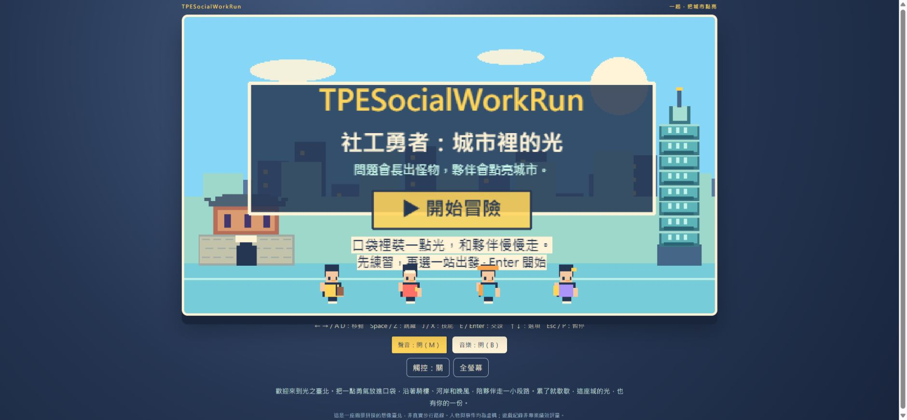
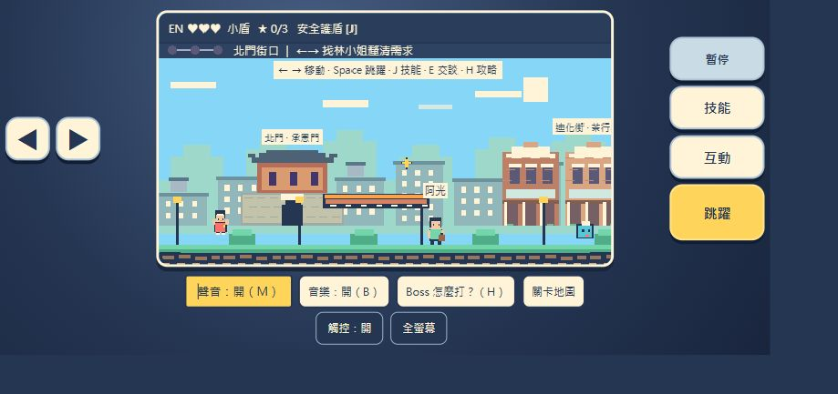
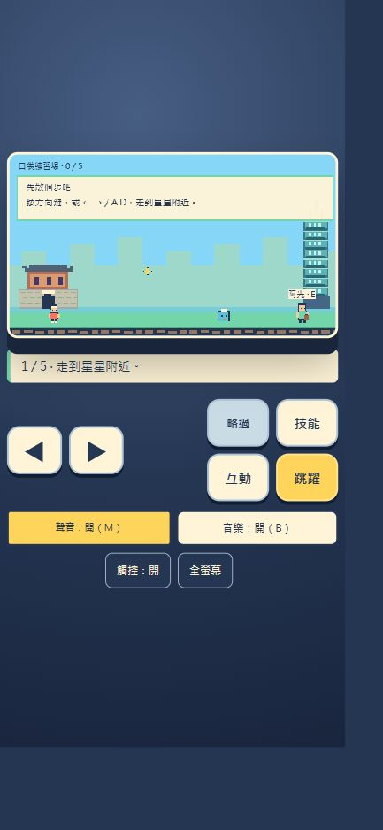
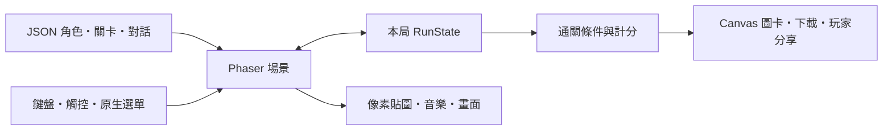

# TPESocialWorkRun｜社工勇者：城市裡的光

一款以臺北街景為靈感的原創 2D 像素平台遊戲。把一點勇氣放進口袋，和夥伴一起跨過障礙、接起資源，讓城市多亮一點。



## 為什麼會有這個專案？

起點非常樸實：某位社工朋友忽然問，能不能幫他做一個小遊戲。

「小遊戲」這三個字，聽起來應該是週末喝杯咖啡就能解決的事。結果咖啡還沒喝完，紙山長出了腳、期限開始在天上飛，最後連工作過載都成了三階段 Boss。朋友只是許了一個願，瀏覽器就多了一座城市。

這是一次週末的小遊戲製作練習，也是一份小小的謝意。謝謝每一位社工工作者，在複雜的制度與日常之間，花時間理解需求、連結支持、陪人走過不容易的時刻。現實沒有重新讀取檢查點，也沒有按一下就補滿的 EN；希望這幾分鐘的冒險，能換來一點笑意與喘息。

**遊戲裡被擊退的是工作與制度障礙，不是需要服務的人。** 社工也不是無限體力的超人；這座城靠的是一起分擔。

## 有什麼可以玩？

- **四位夥伴、四種本領**：需求雷達、安全護盾、友善補給與迷霧澄清，玩法各有不同。
- **先練習，再出發**：可以略過的口袋練習場，學移動、跳躍、踩怪、交談與技能。
- **一趟完整冒險，四區自由練習**：從北門、迪化街、大稻埕河岸走到信義；可看各區說明，也可單獨選關。
- **對話不只按下一頁**：兩個互動事件連動光橋與路線，選錯可以再想一想；檢查點讓人有地方歇腳。
- **三階段 Boss**：踩中分配章、啟動兩側開關、趁核心亮起時接通支持。遊戲內附圖文攻略。
- **自己的冒險紀念**：完整通關可下載 1080×1080 PNG 圖卡；瀏覽器支援時可原生分享，也可複製文字。
- **直拿、橫放都能操作**：直向按鍵在下方，橫向方向鍵與動作鍵分列兩側，支援同時移動和跳躍。
- **像素畫面與原創合成音樂**：圖形由程式繪製，旋律由 Web Audio 合成，沒有外部圖片、音檔或字型下載。

### 橫向遊玩



### 直向練習



截圖為遊戲實際畫面。臺北地景採縮景拼接，並非真實步行路線。

## 自己要玩，怎麼安裝？

準備 **Node.js 22.12 或以上版本**、npm，以及現代瀏覽器。可以從 GitHub 的 **Code → Download ZIP** 下載並解壓縮，或複製自己的 Fork。先在專案根目錄開啟 PowerShell：

```powershell
Set-Location starter
npm ci --ignore-scripts --no-audit --no-fund
npm run dev
```

開啟終端顯示的網址，通常是 `http://localhost:5173`。按 `Ctrl+C` 停止服務。首次安裝需要網路；執行期間不需要 API Key、資料庫或帳號。

想預覽正式建置版本，可在同一個目錄執行：

```powershell
npm run build
npm run preview
```

依終端顯示網址開啟，通常是 `http://localhost:4173`。請透過伺服器遊玩，不要直接雙擊 HTML 檔案。

修改程式後，在 `starter` 目錄執行 `npm test` 與 `npm run build`。回歸測試使用 Node.js 內建測試工具及現有 TypeScript，不需額外安裝測試套件；不會產生測試紀錄檔。macOS／Linux 可使用 `cd starter` 進入相同目錄，其餘 npm 指令相同。

## 怎麼操作？

| 動作 | 鍵盤 | 觸控 |
|---|---|---|
| 移動 | ← → 或 A／D | 左右方向鍵 |
| 跳躍 | Space／Z；按住跳得較高 | 跳躍鍵，可和方向鍵同按 |
| 角色技能 | J／X | 技能 |
| 交談／啟動機關 | 靠近後 E／Enter | 互動 |
| 對話選項 | ↑↓、Enter | 直接點選選項 |
| 暫停 | P／Esc | 暫停；練習場改為略過／選關 |
| Boss 攻略 | H | 遊戲下方攻略按鈕 |
| 全部聲音／背景音樂 | M／B | 聲音／音樂按鈕 |

桌面與小螢幕都有原生選單及對話，可用 Tab 移動焦點、Enter 確認。小視窗或觸控裝置會自動顯示觸控按鍵，也能手動切換。全螢幕與原生分享依瀏覽器支援程度提供；無法開啟全螢幕時仍可直接遊玩。音樂會在第一次操作後啟用。

完整冒險完成兩個事件、光橋、Boss 並走到出口，才會產生正式紀錄。分數為 1500＋協作星數×100，最高 1800；自由選關是練習，不產生正式圖卡。圖卡是遊戲紀念，**不是社工專業績效評量**。

## 技術來源與架構

這是一個純前端、可靜態託管的遊戲，沒有後端、登入或資料庫。

| 技術 | 使用版本 | 在專案中的用途 |
|---|---|---|
| [Phaser](https://phaser.io/) | 4.2.1 | 場景、Arcade Physics、碰撞、鏡頭與像素動畫 |
| [TypeScript](https://www.typescriptlang.org/) | 5.9.3 | 遊戲狀態、事件、角色與模組型別 |
| [Vite](https://vite.dev/guide/) | 8.3.4 | 開發伺服器、模組處理與靜態建置 |
| Canvas 2D | 瀏覽器內建 | 原創像素貼圖、臺北地景與 PNG 圖卡 |
| Web Audio API | 瀏覽器內建 | 原創背景旋律、音效與靜音控制 |
| HTML／CSS／Pointer Events | 瀏覽器內建 | 中文輸入、可捲動選單、直橫向版面與多指操作 |

開發過程使用 OpenAI Codex 協助程式與文件製作。執行遊戲不會呼叫 AI API，也不需要任何 AI 服務帳號。



程式位於 `starter/src`，角色、關卡與台詞位於 `data`，所有場景共用一份本局狀態。更完整的模組說明見 [技術架構](docs/ARCHITECTURE.md)。依賴版本由 lockfile 固定，第三方授權見 [THIRD_PARTY_NOTICES](THIRD_PARTY_NOTICES.md)。

## 當作週末練習，可以改什麼？

可以從改一段 NPC 台詞、一組配色或一小節旋律開始，再試著調整平台與角色技能。這個專案練習的是場景管理、碰撞、資料驅動對話、狀態隔離、響應式輸入與瀏覽器音畫整合。歡迎 Fork、閱讀原始碼，或分享你改出的城市版本。

保留對人的尊重：讓怪物代表障礙，讓夥伴與居民保有自己的聲音。這是遊戲開發練習，不是社工教育、資格認證或實務處遇教材。

## 資料來源與創作界線

社工服務背景參考臺北市政府社會局、家暴暨性侵害防治中心、社區心理衛生中心等官方公開資訊；地景參考臺北旅遊網與市府文化／商業資料。完整連結與對應主題見 [資料來源](docs/SOURCES.md)。

人物、個案、台詞、怪物、光橋與技能均為虛構，不使用真實個案。遊戲不是官方作品，也沒有宣稱機關背書；不提供補助核定、法律或專業處遇建議。程式圖形僅以地景外觀為靈感，未使用官方照片、地圖、Logo 或第三方遊戲素材。

玩家姓名可填暱稱或略過，只留在這一局的記憶體，重新整理即清除。遊戲本身不含追蹤分析或遊玩資料上傳；圖卡下載、文字複製與分享皆由玩家操作。公開網站的主機仍可能保留一般 HTTP 存取紀錄。

## 部署到 Vercel

Repository 根目錄已附 `vercel.json`，使用獨立安裝、建置命令與靜態輸出設定。連接 GitHub 時，**Root Directory 保持 Repository 根目錄**，不要改成 `starter`，因為遊戲也會匯入根目錄的 `data`。Node.js 版本可選 22.x 或較新相容版本，不需要環境變數。

設定對應 [Vercel 官方文件](https://vercel.com/docs/project-configuration/vercel-json)。GitHub 與 Vercel 的連線、專案與網域由部署者自行管理。

## 授權與謝謝

本專案程式、原創台詞、程式生成圖形與合成音樂採 [MIT License](LICENSE)。第三方套件依各自授權；官方來源網站的內容與商標權利屬原權利人。

謝謝那位突然許願的社工朋友，也謝謝每一位在城市裡努力點燈的人。這次換你把工作暫停一下，來踩一隻紙山吧。
