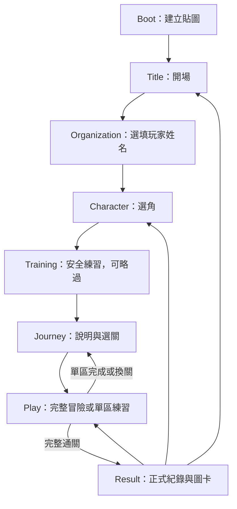

# 技術架構

遊戲使用 TypeScript、Phaser 與 Vite，建置後是靜態 HTML、JavaScript 與 CSS。畫面世界固定為480×270，縮放只改顯示尺寸，不改速度、碰撞或跳躍距離。

## 場景與流程

`starter/src/main.ts` 註冊場景、初始化音訊與響應式版面。`game` 內的 Scene 負責組合畫面與流程，`systems` 負責各自的規則，`art` 負責原創圖形。`OrganizationScene` 與狀態中的 `organizationName` 儲存的是玩家選填稱呼，不作身分認證。

## 核心模組

| 模組 | 職責 |
|---|---|
| RunState | 唯一本局狀態：角色、體力、唯一星 ID、事件、橋、檢查點、Boss 與計時 |
| PlayerController／TouchControls | 整合鍵盤和多指輸入；跳躍緩衝、離地寬容與按住跳躍 |
| Encounters／DialogueController | 純事件完成條件、對話選項、重試回覆與原生選單 |
| StoryWorld | NPC、事件屏障、光橋、休息站與出口 |
| BossController | 分配章、兩側開關、核心三階段及受傷／重生清理 |
| Journey／BossGuide | 四區說明、練習起點與可重看的攻略 |
| ScoreCalculator | 正式通關資格、去重星數、單一計分與唯讀結果快照 |
| ScorecardRenderer／ResultPanel／ResultActions | 1080×1080圖卡、結果畫面、下載、分享與文字複製 |
| AudioBus | 原創音樂、音效、使用者互動解鎖、音樂開關與總靜音 |
| ResponsiveLayout | 可用高度、直橫向顯示、原生選單與Phaser縮放更新 |

## 資料與結果

`data/characters.json` 定義四位角色與技能；`level01.json` 定義世界與物件；`encounters.json` 定義事件；`dialogues.zh-TW.json` 提供繁體中文台詞。程式直接匯入這些JSON，沒有第二份資料副本。

Boss 的 `phases.paper` 定義章的位置、完成數量、預警、紙浪數量與週期；`phases.bridge` 定義開關位置與紙浪；`phases.light` 定義核心位置、命中次數與亮起時間。`BossController`、進度顯示與攻略共同讀取這些參數。章數不得超過可用章的位置數，亮起及預警時間必須短於對應週期。

JSON 的 `schemaVersion`、識別碼與說明文字是資料標記，不是任意行為指令。角色技能實作由角色 ID 決定；固定的安全規則（事件只完成一次、可重試、不設致命深坑、完整冒險需兩事件＋光橋＋Boss）由 TypeScript 維護，不提供互相矛盾的 JSON 開關。NPC 位置只定義於 `level01.json`；事件檔只保留 NPC ID、互動距離、完成選項與結果旗標。

完整冒險與單區練習分開記錄。只有完整冒險完成兩事件、光橋、Boss及正式出口，才能結算；練習即使完成目標，也不會獲得正式圖卡。分數由有效且不重複的星ID及完成條件計算，與姓名、角色無關。

姓名以原生input支援中文組字，限30個Unicode code points，僅當成文字。遊戲狀態留在記憶體，不寫入帳號、資料庫或持久儲存。結果建立快照後不再隨遊戲更新；圖卡在玩家瀏覽器內產生。

姓名在30個 code points 內保留完整字素，不截斷組合表情符號；不可見字元組成的名稱使用「冒險者」。組字期間不截斷、不送出。

## 顯示、輸入與音畫

桌面與小螢幕均提供原生選單及對話，可用 Tab、Enter 與方向鍵操作；開啟時移入焦點，關閉後回到遊戲區。觸控按鍵獨立依裝置與使用者選擇顯示；直向操作鍵在下方，橫向在兩側，世界維持16:9比例。Pointer Events以各pointerId管理按住狀態；取消觸控、失焦、換場景與尺寸變更都會清鍵。平台遊戲畫面仍由 Canvas 呈現，原生選單不代表整個遊戲已具備非視覺遊玩能力。

`Movement` 集中移動、重力、跳躍與固定60Hz物理設定；平台位置由JSON定義。調整平台時需保留起跳及落地餘裕。

原生選單可捲動，CSS保留安全區與整頁縮放。VisualViewport提供可用高度，ResizeObserver通知Phaser更新比例與點擊座標。暫停、對話及攻略協調物理、輸入、計時與音訊，避免閱讀時繼續受傷。

像素貼圖與臺北地景由Canvas／Graphics繪製。重複背景使用共享快取，動態效果維持少量物件；Web Audio以振盪器與增益包絡合成音樂及音效，不載入外部音檔。

## 建置與託管

Vite輸出到`starter/dist`；正式頁只有一個HTML入口，沒有後端API。根目錄`vercel.json`從`starter`安裝依賴、執行build並發布靜態輸出。原生分享、剪貼簿與全螢幕受瀏覽器能力及使用者操作限制，對應介面保留替代方式。
